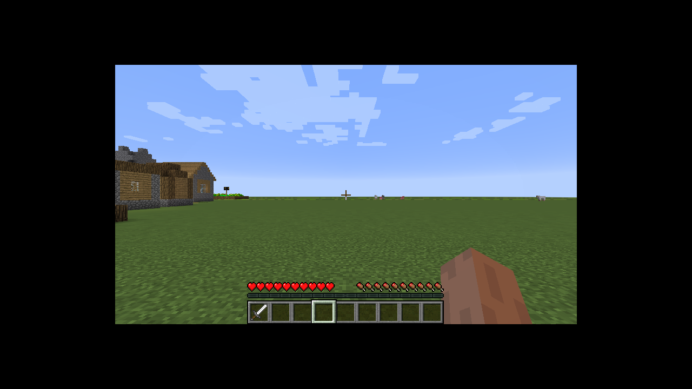

# Live run: Minecraft 1.12.2 (Legacy Fabric)

A production-style launch of Conductor's 1.12.2 mod on Legacy Fabric (loader 0.19.5, legacy Yarn 604), client and
vanilla dedicated server, with the release jars. Run with `scripts/prod-run.sh`.

## The display crash, and its fix

The client died while opening its window, before Conductor started:

```
Caused by: java.lang.ArrayIndexOutOfBoundsException: Index 0 out of bounds for length 0
	at org.lwjgl.opengl.LinuxDisplay.getAvailableDisplayModes(LinuxDisplay.java:951)
	at org.lwjgl.opengl.LinuxDisplay.init(LinuxDisplay.java:738)
	at org.lwjgl.opengl.Display.<clinit>(Display.java:138)
```

Line 951 is `XRandR.getScreenNames()[0]`. LWJGL 2 does not call RandR through X here. It runs the `xrandr -q`
command and parses its output. The sandbox had no `xrandr` binary, so the command failed, no screen was found, and
the array access threw. The X server itself was fine (it reports one 1280x720 output to `xrandr`).

**Fix:** install `x11-xserver-utils` (it provides `xrandr`). `scripts/prod-run.sh` now checks for `xrandr` before a
1.10 to 1.12 run and stops with that message if it is missing.

## Run

```
MC=1.12.2 MODS=conductor-mod/1.12.2/build/libs/conductor-mod-1.12.2-0.6.0.jar \
  CONDUCTOR_MODULES=<dir with example-block-highlighter and example-player-actions> \
  SERVER_ON_JOIN="sleep 5; give Dev minecraft:iron_sword 1" HOLD=120 \
  scripts/prod-run.sh <workdir>
```

Evidence from the run (client log `prod-client.log`, server log `server.log`):

- `LWJGL Version: 2.9.4`; the window opens on Xvfb.
- `Conductor starting 2 module(s)`: `example-block-highlighter-0.6.0` and `example-player-actions-0.6.0` registered.
- `Conductor engine: none (no movement engine installed; travel and combat are unavailable)`: expected on 1.12.2.
- `Dev joined the game` on the server.
- Server commands ran: `[Server: Opped Dev]`, `[Server: Given [Iron Sword] * 1 to Dev]`.
- A chat line from the server reached the client and the modules' chat hook (`chat received: ...`).
- Screenshot `1.12.2-world.png`: the player is in the world with the iron sword in the hotbar.



## Known noise (not failures)

- `OpenAL` errors from `paulscode` (no audio device under Xvfb). The game keeps running.
- `jinput-platform` missing from the classpath (controller support only).
- Asset index `1.12` is missing from the local caches (warning only).

## Not covered yet

This run checks the launch, the window, the join, and the behaviour modules that load on 1.12.2. Server modules
(`server-greeter`), content modules (1.12.2 has no data packs) and the full behaviour checks have not been run on
this version.
